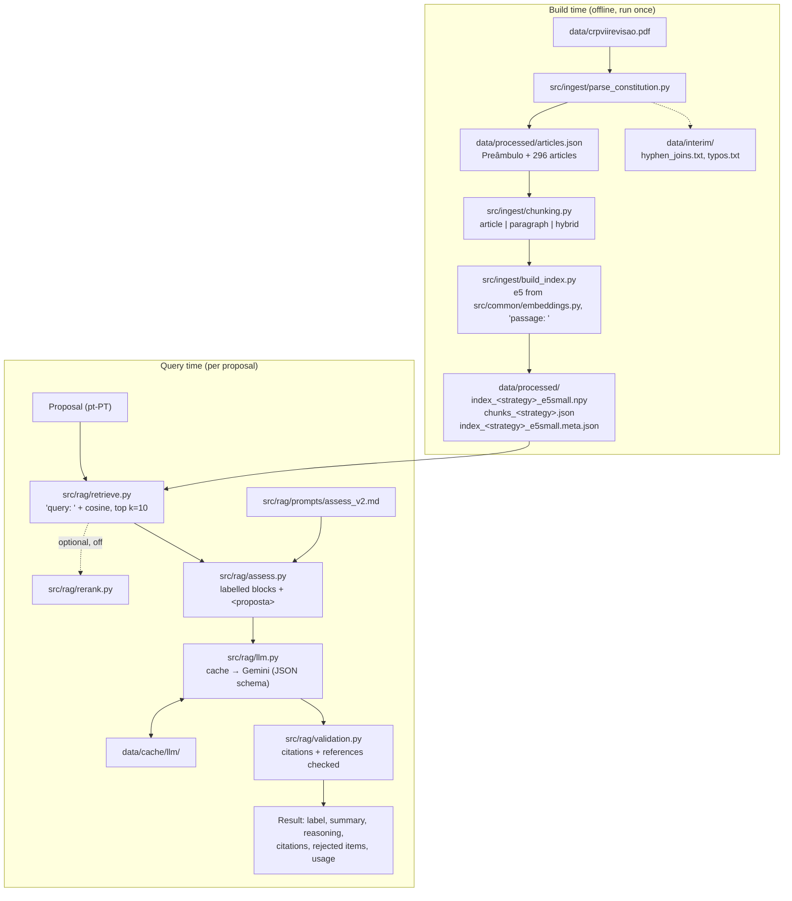

# Architecture

Constitution Checker compares a policy proposal with the Constitution of the
Portuguese Republic (7th revision, 2005) and labels it *likely compatible*,
*potential conflict* or *unclear*, citing specific articles. It is a
retrieval-augmented generation (RAG) pipeline with two phases:

- **Build time** (run once, offline): PDF → clean articles → chunks → embeddings.
- **Query time** (per proposal): embed the proposal → retrieve the closest
  chunks → ask the LLM for a structured assessment → validate it in code.

## Repository layout

```
app/streamlit_app.py      Streamlit UI (European Portuguese)
src/common/               shared: config (all settings and paths), embeddings (e5 model), usage caps
src/ingest/               build time: parse_constitution, chunking, build_index
src/rag/                  query time: retrieve, rerank (off), assess, validation, llm, prompts/
scripts/                  command-line entry points: ask, inspect_pdf, parse_constitution, build_index
eval/                     cases.json, freezes.json, run_eval, compare_llm_runs, assess_smoke,
                          experiments/, legacy/ (old 12-case retrieval test), results/, NOTES.md
tests/                    unit tests mirroring src/: common/, rag/, eval/
data/                     PDF, interim/, processed/ (articles + indexes), cache/llm/, usage/
docs/ARCHITECTURE.md      this file
```

Every path is built from `common/config.py` → `ROOT`, so all commands work
from any working directory. Entry points (`app/`, `scripts/`, `eval/`,
`tests/`) add `src/` to `sys.path` and import packages: `from common import
config`, `from rag.assess import assess`, `from ingest.chunking import ...`.

## Flow



Plain-text version:

```
BUILD   PDF ─► ingest/parse_constitution ─► articles.json ─► ingest/chunking ─► ingest/build_index ─► index + chunks + meta
QUERY   proposal ─► rag/retrieve (index) ─► rag/assess (prompt) ─► rag/llm (cache | Gemini) ─► rag/validation ─► result
```

Safety properties that hold across the pipeline:

1. **The index must match the model.** `rag.retrieve.load_index` refuses an
   index whose metadata (model name + revision) differs from the loaded model;
   the app refuses to start if the reranker revision (when enabled) differs
   from config. If the Gemini model version (`models.get`) differs, the app
   starts but answers with retrieval only (no LLM); the same happens when no
   API key is set. An "unreachable" check is repeated after 5 minutes
   (`rag.llm.ModelStatus`), so a network blip at startup does not stick.
2. **The LLM is never trusted.** `rag.validation.validate_output` drops
   citations and in-text references to articles that were not retrieved, and
   forces `unclear` when the answer cannot be backed by what the model was shown.
3. **Quota is protected.** Every real Gemini request passes the usage guard
   (`common.usage`); cache hits never count.

## Files

### `src/common/config.py`
- **Purpose:** every setting and path (no secrets; the API key is in `.env`).
- **Main names:** `ROOT`, `DATA_DIR`, `PDF_PATH`, `INTERIM_DIR`, `PROCESSED_DIR`, `EVAL_DIR`, `ENV_PATH`,
  `PROVIDER`, `MODEL`, `MODEL_VERSION`, `TEMPERATURE`, `RPM_LIMIT`, `RPD_LIMIT`, `TPM_LIMIT`,
  `MAX_RETRIES`, `CACHE_DIR`, `FORCE_LLM_UNAVAILABLE`, `DAILY_CAP`, `SESSION_CAP`, `USAGE_DIR`,
  `QUOTA_TIMEZONE`, `PROMPT_VERSION`, `PROMPTS_DIR`, `RETRIEVAL_STRATEGY`, `RETRIEVAL_K`,
  `MAX_PROPOSAL_CHARS`, `RERANK_*`, `LABELS`.
- **Used by:** almost every module.

### `src/common/embeddings.py`
- **Purpose:** the embedding model, shared by build time and query time.
- **Main names:** `MODEL` (name, pinned revision, short name, `passage: ` / `query: ` prefixes, 512 tokens);
  `load_model()` — downloads only safetensors at the pinned revision, `trust_remote_code=False`, records `hf_name`/`hf_revision`.
- **Used by:** `ingest/build_index.py`, `rag/retrieve.py`, the app and `eval/run_eval.py` (model name in reports).

### `src/common/usage.py`
- **Purpose:** usage caps for the app.
- **Main names:** `DailyCounter` (every API request, global, file `data/usage/daily.json`, reset at midnight Pacific,
  `threading.Lock`, atomic writes); `make_guard(daily, session_state, session_cap)` — one guard per question:
  the session cap counts new analyses, retries count only against the daily cap; `UsageLimitError`.
- **Used by:** the app.

### `src/ingest/parse_constitution.py`
- **Purpose:** turn the PDF into one clean record per article.
- **Main functions:** `reading_order_lines` (rotated 2-up pages in reading order), `fix_ligatures`,
  `clean_body_lines` (drop headers/footers), `build_vocab` + `join_lines` (hyphenation repair),
  `parse` (state machine: parts, títulos, capítulos, articles, paragraphs, alíneas),
  `write_hyphen_log`, `write_typos`, `validate` (296 articles, titles, numbering, no noise), `main`.
- **Inputs → outputs:** `data/crpviirevisao.pdf` → `data/processed/articles.json`, `data/interim/hyphen_joins.txt`, `typos.txt`.
- **Run via:** `scripts/parse_constitution.py`.

### `src/ingest/chunking.py`
- **Purpose:** turn articles into text chunks with a context prefix.
- **Main functions:** `make_chunks(articles, strategy, max_words, length_fn, prefix_version)`,
  `split_by_paragraph`, `split_by_alinea` (chunks over 512 tokens split at alínea boundaries),
  `make_prefix` (e.g. `"Artigo 24.º, n.º 1 — Direito à vida: "`), `label`, `load_articles`;
  `hierarchy`/`sentence_case` (only for the rejected `v2_hierarchy` prefix).
- **Used by:** `ingest/build_index.py`, `rag/assess.py`, `rag/validation.py`, the app, `scripts/ask.py`, eval scripts.

### `src/ingest/build_index.py`
- **Purpose:** embed the chunks of each strategy and save the index.
- **Main functions:** `token_counter`, `embed` (normalised float32), `build`, `validate`
  (counts, norms, token limits, re-embedding), `main` (`--strategy`, `--prefix-version`).
- **Outputs:** `data/processed/index_<strategy>_e5small.npy`, `chunks_<strategy>.json`, `index_<strategy>_e5small.meta.json`.
- **Run via:** `scripts/build_index.py`.

### `src/rag/retrieve.py`
- **Purpose:** find the chunks closest to a query.
- **Main functions:** `retrieve(query, strategy=None, k=None, rerank=None, candidates=None)` — defaults from config;
  `load_index(strategy)` — loads once and checks against the loaded model (`IndexMismatchError`); `get_model()`.

### `src/rag/rerank.py`
- **Purpose:** optional cross-encoder rerank stage, **off by default** (rejected in the experiment, see `eval/NOTES.md`).
- **Main functions:** `load_reranker()` (pinned revision, safetensors only, `RerankerMismatchError`), `rerank_hits(query, hits, k, scorer)`.

### `src/rag/llm.py`
- **Purpose:** provider-agnostic JSON generation with retries and a disk cache.
- **Main names:** `LLMClient.from_config(prompt_version)`, `generate_json(system_prompt, user_prompt, schema, validate,
  before_api_call)` (retries once on bad JSON, caches only valid answers), `cache_key` (SHA-256 of provider, model,
  model version, prompt version, system and user prompt), `verify_model` ("ok" / "unreachable" / "mismatch"), `stats` (api_calls, cache_hits,
  transport_retries, output_retries); `GeminiProvider` (`call`, `is_retryable`: 429, 5xx, network/httpx errors,
  `model_version`; raises `MissingAPIKeyError` without a key); `MinuteRateLimiter`; `ModelStatus` (startup check kept per
  process, "unreachable" re-checked); `LLMUnavailableError`, `LLMOutputError`, `MissingAPIKeyError`.
- **Inputs:** `GEMINI_API_KEY` from `.env` (`config.ENV_PATH`). **Outputs:** cache files in `data/cache/llm/`.

### `src/rag/validation.py`
- **Purpose:** check an LLM answer against the retrieved chunks (pure functions, no model or API).
- **Main functions:** `validate_output(data, hits)` → `(result, rejected_citations, rejected_references, notes)`;
  `extract_references`, `check_structure`, `shown`, `problem`, `existing_paragraphs`.

### `src/rag/assess.py`
- **Purpose:** the query-time pipeline for one proposal.
- **Main functions:** `assess(proposal, strategy, k, before_api_call, prompt_version)`; `build_user_prompt`;
  `chunk_block`; `get_client(prompt_version)`, `get_system_prompt(prompt_version)`; `SCHEMA`.

### `src/rag/prompts/assess_v1.md`, `assess_v2.md`
- **Purpose:** the system prompt in European Portuguese. `assess_v2` (default) = `assess_v1` + rule 8 (one-sided evidence → `unclear`).

### `app/streamlit_app.py`
- **Purpose:** the UI: proposal box, examples, label badge, citations with article text, retrieved chunks,
  technical details, disclaimer, sidebar; startup checks; retrieval-only fallback on caps or LLM outage.

### Scripts (`scripts/`)

| File | Purpose |
|---|---|
| `ask.py` | CLI: `--retrieval-only` (offline, 0 quota), `--strategy`, `--k`, `--show-prompt`, `--json` |
| `parse_constitution.py`, `build_index.py` | thin wrappers that run the ingest modules |
| `inspect_pdf.py` | step 1 PDF inspection (writes `data/interim/raw_text*.txt`) |

### Evaluation (`eval/`)

| File | Purpose |
|---|---|
| `cases.json`, `freezes.json` | answer key (dev/test) and freeze time per batch |
| `run_eval.py` | full evaluation: retrieval ranks + LLM, metrics per set; `--set`, `--k`, `--prompt`, `--max-api-calls`, `--overwrite` |
| `compare_llm_runs.py` | two runs side by side: metrics, safety checks, improvements, regressions, `--show` |
| `assess_smoke.py` | 5-proposal LLM smoke test, run twice (2nd pass must be cached) |
| `experiments/` | `rerank.py`, `missing_info_retrieval.py`, `token_stats.py` |
| `legacy/` | old 12-case retrieval test (`retrieval_test.py`, `compare_runs.py`, `retrieval_cases.json`) |
| `results/` | `baseline_v1` (frozen baseline) and `final_test` at the top; `dev/` the dev runs and comparisons behind each adopted decision; `experiments/` side experiments, smoke tests and the legacy retrieval runs |
| `NOTES.md` | the decision log, ending with "Future work" |

### Tests (`tests/`)
- `rag/test_validation.py` (reference extraction, citation rules), `rag/test_rerank.py`,
  `rag/test_cache_key.py` (k=10 never reuses k=8 answers), `rag/test_retryable.py`;
  `common/test_usage.py` (caps, reset, concurrency, retries vs session cap);
  `eval/test_run_eval.py` (metrics, freeze checks). No model, no API.

## Where is X defined?

| Setting | Value | Defined in (file → name) |
|---|---|---|
| Embedding model + revision | `intfloat/multilingual-e5-small` @ `614241f6…` | `src/common/embeddings.py` → `MODEL` ⚠ also `eval/experiments/token_stats.py` |
| Embedding prefixes | `"passage: "` / `"query: "` | `src/common/embeddings.py` → `MODEL` (query prefix read back from index metadata) |
| Embedding token limit | `512` | `src/common/embeddings.py` → `MODEL["max_seq_length"]` ⚠ also `src/ingest/chunking.py` → `MAX_TOKENS` |
| Alínea split target | `400` tokens | `src/ingest/chunking.py` → `TARGET_TOKENS` |
| LLM provider / model / version | `gemini` / `gemini-3.5-flash-lite` / `3.5-flash-lite-07-2026` | `src/common/config.py` → `PROVIDER`, `MODEL`, `MODEL_VERSION` |
| Temperature | `0` | `src/common/config.py` → `TEMPERATURE` |
| Chunk strategies | `article`, `paragraph`, `hybrid` | `src/ingest/chunking.py` → `STRATEGIES` ⚠ also `eval/legacy/compare_runs.py` |
| Default strategy / k | `hybrid` / `10` | `src/common/config.py` → `RETRIEVAL_STRATEGY`, `RETRIEVAL_K` |
| Hybrid threshold | `200` words | `src/ingest/chunking.py` → `DEFAULT_MAX_WORDS` |
| Prefix version | `v1_basic` | `src/ingest/chunking.py` → `DEFAULT_PREFIX_VERSION` (recorded per index in `*.meta.json`) |
| Prompt version | `assess_v2` | `src/common/config.py` → `PROMPT_VERSION`; files in `src/rag/prompts/` |
| Rerank (off) | model, revision, 30 candidates | `src/common/config.py` → `RERANK_*` |
| Rate limits | 15 RPM, 500 RPD, 250 000 TPM | `src/common/config.py` (only `RPM_LIMIT` enforced; daily quota via `DAILY_CAP`) |
| Usage caps | 400/day (every request), 10/session (new analyses) | `src/common/config.py` → `DAILY_CAP`, `SESSION_CAP` (env-overridable) |
| Label codes + names | 3 codes → pt-PT names | `src/common/config.py` → `LABELS` ⚠ codes also written in the prompts |
| Paths | repo root, data, eval, `.env`, cache, prompts | `src/common/config.py` (single source) |
| PDF layout | `MID_Y = 298`, `FIRST_BODY_PAGE = 9` | `src/ingest/parse_constitution.py` ⚠ also `scripts/inspect_pdf.py` |
| Evaluation ks | retrieval test `5, 8`; run_eval `@5/@8/@10/@12` | `eval/legacy/retrieval_test.py`, `eval/run_eval.py` |

Remaining duplicates (⚠): the e5 settings in `token_stats.py` (a frozen step-3
comparison), the 512 limit in `chunking.MAX_TOKENS`, the strategy list in
`legacy/compare_runs.py`, the PDF layout constants in `inspect_pdf.py`, and the label codes
in the prompt text. Resolved by the reorganisation: all paths now come from
`config.py`, and the embedding model is defined once in `common/embeddings.py`.

## How to test

All commands run from the project root on Windows (they also work from any
other folder). Only the ones marked as costing API calls use Gemini quota.

**Unit tests** (no model, no API):
```
.venv\Scripts\python -m unittest discover -s tests -t . -v
```

**Dev evaluation** (cache first; stops before sending if more calls than allowed would be needed; never run the test set before the final evaluation):
```
.venv\Scripts\python eval\run_eval.py --run-name my_run --set dev --max-api-calls 0
.venv\Scripts\python eval\compare_llm_runs.py dev/baseline_k10_dev30 my_run --out my_comparison
```

**Smoke test** (5 proposals, run twice; up to 5 API calls the first time, 0 when cached):
```
.venv\Scripts\python eval\assess_smoke.py --run-name my_smoke_run
```

**Legacy retrieval test** (12 cases × 3 strategies; no LLM):
```
.venv\Scripts\python eval\legacy\retrieval_test.py --run-name my_run
.venv\Scripts\python eval\legacy\compare_runs.py v1_basic_prefix my_run
```

**ask.py** (retrieval only: offline, 0 quota; with the LLM: 1 API call or 0 if cached):
```
.venv\Scripts\python scripts\ask.py "Reintroduzir a pena de morte" --retrieval-only
.venv\Scripts\python scripts\ask.py "Reintroduzir a pena de morte"
.venv\Scripts\python scripts\ask.py "Reintroduzir a pena de morte" --show-prompt --json
```

**App:**
```
.venv\Scripts\python -m streamlit run app\streamlit_app.py --server.address localhost
```

**Rebuilding the data** (only after changing the parser or chunking):
```
.venv\Scripts\python scripts\parse_constitution.py
.venv\Scripts\python scripts\build_index.py
```
